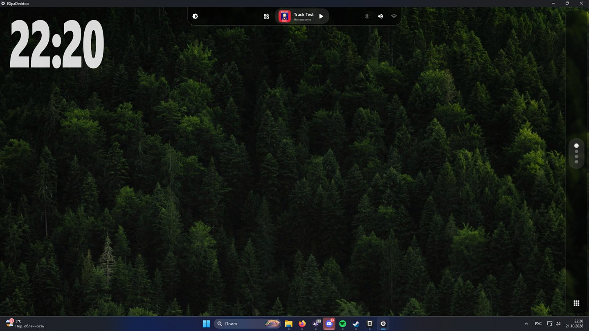

<div align="center">

# 🪟 EXpaDesktop

**A custom desktop launcher for Windows — glassy, alive, with liquid animations**

Flutter · Rust · Glassmorphism · Liquid Glass


</div>

---

## ✨ What is this

EXpaDesktop replaces the standard desktop with its own shell: giant
clock, wallpaper slideshow, floating glass panels and a built-in music
player — everything opens and closes **as a drop of liquid glass**
that grows out of a button and dissolves back into it.



## 🌊 Liquid Glass Animations

Panel animations are a Dart port of
[liquid-dom](https://github.com/AndrewPrifer/liquid-dom) / liquid-glass,
with all the physics:

| Stage | What happens |
|-------|--------------|
| 🟢 Opening | The button's capsule draws itself into a round drop → the drop is **thrown** toward where the panel will be, pushed by a spring and a random nudge (no two openings are alike) → it swells to the panel's size as its corners square off |
| 🔵 Content | The content is seen as if **deep inside the glass** and rises to the surface while the drop grows |
| 🔴 Closing | The panel shrinks back into a drop → the drop rises into the button, stretching into its capsule on the way → and fades there |
| ⚡ Reversal | Close right in the middle of an opening — the velocity carries over and the drop turns around without a blink |

The physics is damped springs (semi-implicit Euler, sub-stepped),
verified by mock tests: **53/53 PASS**, including 200 randomized fuzz
runs and 300 ms stress frames.

## 🎵 Music Player

- A track fades in over ~250 ms instead of slamming the room at full level; **pause keeps the position**, play resumes exactly there
- Covers come from the mp3 itself: the player reads the ID3v2 APIC frame, so a dropped file shows its own artwork with no config
- **Wavy slider** in the Material Design style — the active track lives as a sine wave, surging while you drag
- The thumb grows on hover and **stretches like a droplet** against the drag direction
- 🟠 Loop the current track, repeat the playlist, shuffle order (the `•••` menu)
- Buttons spring like Google Gemini ones: pressing stretches them into an oval, releasing snaps them back elastically
- Track list — dark glass cards with smooth edge fade while scrolling

## ☀️ Display Control

Through a native Rust DLL (`FFI`) — real hardware, not overlays:

| Function | How |
|----------|-----|
| Brightness | DDC/CI `SetMonitorBrightness` + a software gamma-ramp boost above the maximum |
| Contrast | DDC/CI `SetMonitorContrast` |
| Warmth | Gamma ramp `SetDeviceGammaRamp` (cuts the blue-red channels) |

All three sliders use the same wavy WaveSlider as the player.

## 🖥️ The Shell

- A 145 px clock, wallpapers rotating every 12 seconds with a crossfade
- Top panel with "glass" (BackdropFilter): apps, mini-player, bluetooth / volume / wi-fi
- Right dock: the apps button, four dots for virtual desktops and nine dots for the launcher
- Power menu behind the apps button (lock / sign out / restart / sleep / shutdown / settings)
- Settings window: 7 sections, draggable by its title bar, minimizes into the dock, opens on a bouncy spring

## 🎛️ Settings that actually switch things

The parameters the shell can drive itself live **in the shell**, not behind a
link to Windows:

| Parameter | Read from | Switched by |
|-----------|-----------|-------------|
| Volume / mute | `IAudioEndpointVolume` (COM) | the same endpoint, no windows opened |
| Wi-Fi | `Windows.Devices.Radios` + `Get-NetAdapter` | `Radio.SetStateAsync` — the API behind the taskbar's quick settings, no UAC |
| Bluetooth | `Windows.Devices.Radios` | `Radio.SetStateAsync` |
| Brightness | the Rust DDC/CI DLL | the same DLL |

`ms-settings:` is the fallback: the rows the shell does not own ("Default
apps", "Windows Update", …) still open the matching Windows page, but every
row the shell owns shows its real state and a switch that works.

Opening a radio goes through a hidden PowerShell bridge (`CreateProcessW`
with `CREATE_NO_WINDOW`, so no console flashes) and a worker isolate, so the
UI never waits on a process. Windows' own radio API answers something real —
the shell shows what the machine reports, including "device not found" and
"blocked by the system".

### Command line

`Ctrl+Alt+Space` opens a one-line command field. Type «включи вайфай»,
«громкость 40», «заглуши звук», «открой настройки блютуза» — the phrase goes
through the same sink as the buttons and the reply appears under the field.
The phrase matcher and the assistant's system prompt live in
[`PROMPTS.md`](PROMPTS.md).

## 🧩 Structure

```
ExDesktop/
├── lib/
│   ├── main.dart                # shell: wallpapers, clock, panels, dock
│   ├── player.dart              # player: transport, slider, track list
│   ├── settings_app.dart        # spring-driven settings + live parameter panes
│   ├── sound_control.dart       # one owner of the master volume and mute
│   ├── radio_control.dart       # Wi-Fi / Bluetooth state and switching
│   ├── radio_script.dart        # the PowerShell bridge to Windows' radio API
│   ├── hidden_process.dart      # console tools with no console window
│   ├── native_heap.dart         # malloc/free for the FFI modules
│   ├── assistant_prompt.dart    # the assistant's system prompt + catalog
│   ├── command_router.dart      # phrases → intents → machine actions
│   ├── shell_layout.dart        # where every panel sits, as testable numbers
│   ├── shell_panels.dart        # which surface may share the screen with which
│   ├── virtual_desktops.dart    # Win+Ctrl chords for the desktop switcher
│   ├── id3_art.dart             # title / artist / cover from the mp3 tags
│   ├── track_art.dart           # one artwork rule: cover, asset, placeholder
│   ├── liquid_glass/            # 🔬 physics & widgets
│   │   ├── menu_morph.dart      #   capsule→drop→panel morph
│   │   ├── menu_spring.dart     #   bouncy scale (settings)
│   │   ├── spring.dart          #   damped spring
│   │   ├── morph_controller.dart#   tickers, open/close/reverse
│   │   ├── morph_glass.dart     #   rendering: lens, glass, blur
│   │   ├── wave_slider.dart     #   wavy Material slider
│   │   └── stretch_icon_button.dart  # Gemini-style buttons
│   └── rust/
│       ├── src/lib.rs           # DDC/CI + gamma ramps (Rust)
│       └── brightness.dll       # prebuilt native library
├── assets/
│   ├── fons/                    # 8 wallpapers
│   ├── music/                   # tracks and cover art
│   └── icons/
└── test/
    ├── mock_harness.dart             # 🧪 shared check/report harness
    ├── mock_all.dart                 # 🧪 everything, one total
    ├── liquid_glass_mock_check.dart  # 🧪 53 physics mock tests
    ├── shell_check.dart              # 🧪 310 layout/policy/ID3/desktop checks
    ├── system_mock_check.dart        # 🧪 415 system + assistant mock tests
    └── widget/
        ├── settings_app_test.dart    # 🧪 11 widget tests: panes, switches
        ├── shell_test.dart           # 🧪 12 widget tests: surfaces, tap-away, desktops
        └── track_art_test.dart       # 🧪 4 widget tests: artwork fallbacks
```

`windows/` holds the generated runner (CMake + C++ window host).

## 🚀 Getting it running

**The repo ships sources, not binaries** — `build/` and every artefact stay on
your machine. Build it once, here is the whole path from a clean Windows.

### 1. Flutter

```powershell
# any folder without spaces or Cyrillic; C:\src is the usual choice
New-Item -ItemType Directory -Force C:\src | Out-Null
curl.exe -L -o C:\src\flutter.zip https://storage.googleapis.com/flutter_infra_release/releases/stable/windows/flutter_windows_3.47.7-stable.zip
tar.exe -xf C:\src\flutter.zip -C C:\src
Remove-Item C:\src\flutter.zip
[Environment]::SetEnvironmentVariable("Path", "C:\src\flutter\bin;" + [Environment]::GetEnvironmentVariable("Path", "User"), "User")
```

Open a new terminal and check `flutter --version`.

### 2. The C++ toolchain (needed to build a Windows app)

Visual Studio Installer → **Modify** → tick **Desktop development with C++**
(MSVC, C++ CMake tools, Windows 10/11 SDK). `flutter doctor` turns green when
it sees them.

### 3. Developer Mode

Flutter symlinks plugin packages on Windows, which needs symlink support:

```powershell
start ms-settings:developers
```

→ turn **Developer Mode** on.

### 4. `nuget.exe` on PATH

`audioplayers_windows` asks CMake to download `nuget.exe` while configuring,
and that downloader is flaky (`schannel: server closed abruptly`). A local copy
makes the plugin skip the download:

```powershell
New-Item -ItemType Directory -Force C:\src\nuget | Out-Null
curl.exe -L -o C:\src\nuget\nuget.exe https://dist.nuget.org/win-x86-commandline/v6.5.0/nuget.exe
$env:Path = "C:\src\nuget;$env:Path"
```

### 5. Run it

```powershell
cd ExDesktop
flutter pub get
flutter run -d windows            # debug, with hot reload
flutter build windows --release   # -> build\windows\x64\runner\Release\exp_desktop.exe
```

The release folder is self-contained: `exp_desktop.exe`, `flutter_windows.dll`,
`audioplayers_windows_plugin.dll`, `brightness.dll` and `data\flutter_assets\`.
The Windows runner lives in `ExDesktop/windows/` (generated with
`flutter create --platforms=windows .` and committed, so a fresh clone builds).

The Rust DLL is vendored prebuilt at `lib/rust/brightness.dll`; rebuild it with
`cd lib/rust; cargo build --release; cp target/release/brightness.dll .`.

## 🧪 Tests

Widget tests run under `flutter test`; the system, shell and physics suites are
plain Dart scripts (no Flutter needed). `mock_all.dart` runs all of them and
prints a single total — **778 checks**, plus **27 widget tests**.

```bash
cd ExDesktop
flutter test                                 # 27 widget tests
flutter analyze                              # No issues found
dart run test/mock_all.dart                  # 778 mock checks
dart run test/liquid_glass_mock_check.dart   # physics only, 53 checks
dart run test/system_mock_check.dart         # system + assistant, 415 checks
dart run test/shell_check.dart               # layout, panels, ID3, desktops: 310 checks
```

```
[liquid glass]    ✓ springs, morphs, reversal, 200 fuzz runs, COM volume probe
[hidden process]  ✓ stdout/stderr/exit codes, 20k-line output, timeout kill,
                    UTF-16LE -EncodedCommand, Cyrillic round-trip
[native heap]     ✓ write/read, 2000 alloc/free cycles, free(nullptr)
[radio script]    ✓ no leftover placeholders, UTF-8 output, SetStateAsync
[radio parsing]   ✓ every state, disabled adapter, adapter-only, CRLF,
                    malformed lines, unknown radio kinds
[radio labels]    ✓ Russian state strings for both radios
[command parser]  ✓ 100+ phrasings: radios, volume (digits, %, Russian
                    numerals), mute, settings sections, media, brightness,
                    power — plus the traps that used to misfire
[router]          ✓ every intent reaches the sink and answers in one line
[prompt]          ✓ every catalog intent is in the prompt, every catalog
                    example parses to its own intent
[sound]           ✓ read-only endpoint checks, listeners fire and detach
[window guards]   ✓ the sound path contains no window-visibility calls
passed: 682   failed: 0 — ALL GREEN
```

## 📄 License

[MIT](LICENSE) © 2026 Suptemen

<div align="center">

**EXpaDesktop** — a desktop that flows 🌊

</div>
